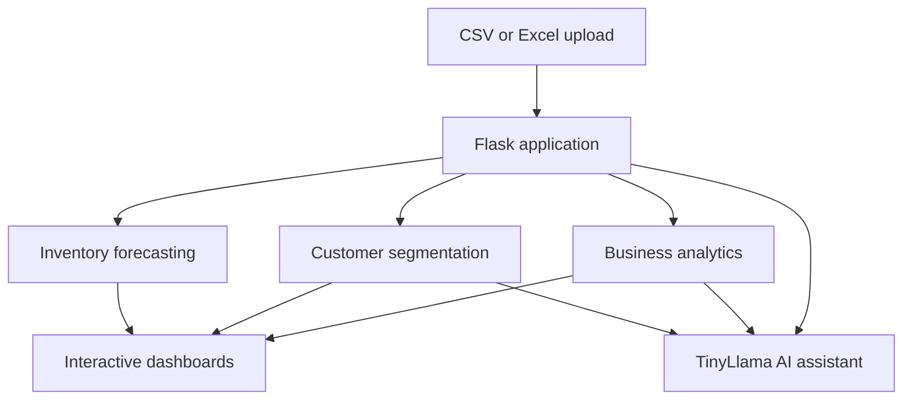

# AI-Powered Retail Sales Forecasting System

A Python and Flask web application that transforms retail transaction data into business intelligence dashboards, sales forecasts, customer segments, inventory recommendations and conversational AI insights.

## Project overview

Retail businesses need to understand historical sales, anticipate demand and make informed inventory decisions. This project combines data analytics, machine learning and a locally executed language model in a single web interface. Users upload transaction data and explore three analytical dashboards without manually building reports.

## Key features

| Module | Capabilities |
| --- | --- |
| Business analytics | Sales KPIs, daily and monthly trends, product and category analysis, 30-day and 90-day forecasts |
| Customer analytics | Pretrained five-cluster K-Means model, customer spending analysis, weekend and festive purchasing patterns, segment visualizations |
| Inventory analytics | 30-day product demand forecasts, safety stock, reorder points, target stock and restocking recommendations |
| AI assistant | TinyLlama chatbot that uses dashboard and uploaded-data context to answer retail questions |
| Data ingestion | CSV and Excel uploads, flexible column detection and multi-sheet Excel processing in business analytics |

## Machine learning methods

- **Random Forest Regression:** normalized sliding-window time-series forecasting with recursive predictions.
- **Holt's linear exponential smoothing:** trend-based sales forecasting.
- **Random Forest and XGBoost ensemble:** averaged predictions for product demand, with a historical-mean fallback.
- **K-Means clustering:** pretrained customer segmentation using weekend and festive purchasing features, including Chinese New Year, Hari Raya, Merdeka, Deepavali and Christmas. Spending quantiles provide a fallback if the saved model cannot be loaded.
- **TinyLlama 1.1B Chat:** Hugging Face Transformers text-generation pipeline running on the CPU via PyTorch.

**Implementation note:** Sales forecasting uses Random Forest, not LSTM. Forecast ranges are heuristic and model accuracy has not been validated.

## Technology stack

| Area | Technologies |
| --- | --- |
| Language | Python |
| Web application | Flask, Jinja2, HTML, CSS, JavaScript |
| Data processing | Pandas, NumPy, openpyxl |
| Machine learning | Scikit-learn, XGBoost, Joblib |
| Generative AI | PyTorch, Hugging Face Transformers, TinyLlama |

## System architecture



## Project structure

```text
AI-Powered-Retail-Sales-Forecasting-System/
├── app.py
├── logic_business.py
├── logic_customer.py
├── logic_stocks.py
├── kmeans_model_5clusters.joblib
├── scaler_5clusters.joblib
├── requirements.txt
├── templates/
│   ├── base.html
│   ├── welcome.html
│   ├── upload.html
│   ├── business.html
│   ├── customer.html
│   └── stocks.html
├── uploads/                       # Created automatically; keep private data out of Git
└── README.md
```

## Getting started

### 1. Clone the repository

After publishing the repository under the suggested name:

```bash
git clone https://github.com/Havidrak/AI-Powered-Retail-Sales-Forecasting-System.git
cd AI-Powered-Retail-Sales-Forecasting-System
```

### 2. Create a virtual environment

Python 3.10 or 3.11 is a suggested starting point; compatibility has not been tested.

```bash
python -m venv .venv
```

Windows PowerShell:

```powershell
.\.venv\Scripts\Activate.ps1
```

macOS/Linux:

```bash
source .venv/bin/activate
```

### 3. Install dependencies

Install the core dashboard dependencies:

```bash
python -m pip install --upgrade pip
python -m pip install -r requirements.txt
```

For the optional TinyLlama chatbot, install `requirements-ai.txt` instead:

```bash
python -m pip install -r requirements-ai.txt
```

The saved models may require their original training library versions. Only load trusted Joblib files. Chatbot weights may require internet access and substantial memory and disk space.

### 4. Configure credentials and optional AI

No credentials are stored in the source. By default a random session key is generated on startup. To preserve sessions across restarts, set a stable, securely generated `SECRET_KEY` in your shell. Do not commit secrets. Revoke any previously exposed Hugging Face token.

Enable the optional chatbot in PowerShell with:

```powershell
$env:ENABLE_CHATBOT = "1"
```

On macOS/Linux use `export ENABLE_CHATBOT=1`. Set `HF_TOKEN` only if model authentication is required. The chatbot loads on the first question; without it the application returns available dashboard facts. The `.env.example` file is a reference, not automatically loaded.

### 5. Launch the application

```bash
python app.py
```

Open <http://127.0.0.1:5000> in your browser. Run from the project root so that the saved clustering model and scaler can be found. The application starts with debug mode disabled and is intended for local development, not public production hosting.

## Example input data

The following synthetic CSV illustrates useful columns for all three dashboards. Use a larger dataset covering many dates and customers for meaningful forecasts and segmentation.

```csv
Date,Customer ID,Product Name,Category,Quantity,Sales
2026-01-01,C001,USB Cable,Accessories,2,40
2026-01-02,C002,Wireless Mouse,Peripherals,1,65
2026-01-03,C001,Phone Charger,Charging,1,35
```

Sales should represent transaction totals. Customer analytics needs customer identifiers; inventory analytics needs dates, product names and quantities. Prefer CSV or `.xlsx` files. Never publish real customer data without permission and appropriate anonymization.

## Dashboard workflow

1. Open the application and upload a retail dataset.
2. Explore the business dashboard to review sales KPIs and forecasts.
3. Open customer analytics to inspect segment distributions and spending patterns.
4. Use stock analytics to review predicted demand and reorder recommendations.
5. Ask the AI assistant questions about the uploaded data.

## Business applications

- Sales planning and demand forecasting
- Customer targeting and seasonal marketing
- Inventory replenishment and stockout risk assessment
- Retail performance reporting and decision support

## Limitations and future improvements

This is a portfolio prototype, not a validated production forecasting system. Forecast bands are heuristic, stock analysis uses a default stock quantity of 100 rather than a live inventory feed. The application has not been independently tested for accuracy, performance or deployment readiness.

Potential improvements:

- Evaluate forecasts with chronological train/test splits and MAE, RMSE or MAPE.
- Compare forecasting models and implement a genuine LSTM if needed.
- Integrate actual stock balances and supplier lead times.
- Add automated tests, upload validation, authentication and production configuration.
- Document reproducible model training and verify dependencies in a fresh environment.
- Add actual dashboard screenshots and deployment instructions after testing.

## Screenshots

Add actual dashboard screenshots in the `screenshots/` folder after running the application locally. Original uploaded datasets are excluded from this public-ready package to avoid publishing unverified private data.

## Author

GitHub: [Havidrak](https://github.com/Havidrak)

## License

No license is currently included. Add an appropriate license only if you have the rights to distribute the project and its associated assets.
